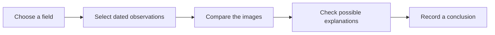
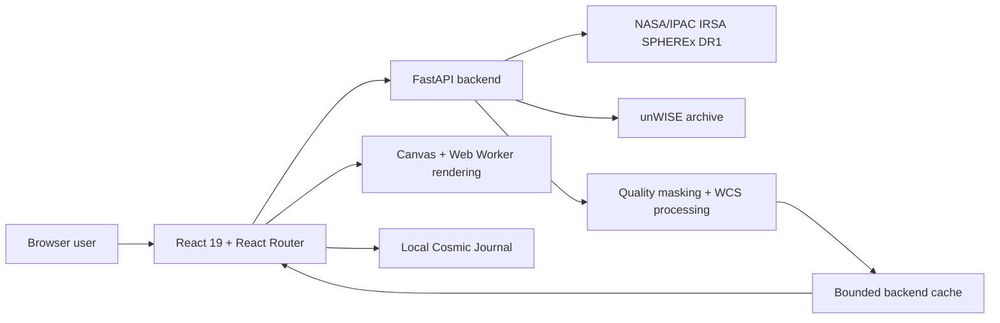

# Gemini AI Studio Brief — SPHEREx Sky Explorer Submission PPT

> Copy this file into Gemini AI Studio to generate the submission presentation. Replace every `[ADD …]` placeholder before submission.

## Instructions for Gemini

Create a polished **12-slide hackathon submission deck** for **SPHEREx Sky Explorer**. This is a self-contained project presentation, not a speech deck.

Each slide must explain the project using concise text, diagrams, verified facts, and screenshots. Do **not** add speaker notes, a narration script, fictional results, invented testimonials, or unsupported claims.

### Design system

- Professional NASA-inspired editorial style.
- Deep-space background: `#07090E`.
- Warm amber accent: `#D8B26E`.
- Cool blue-gray secondary accents.
- Serif display headings, clean sans-serif body text, small monospace metadata.
- Use large screenshots, thin scientific lines, coordinates, dates, and restrained telemetry details.
- Prefer one main idea per slide.
- Avoid neon effects, cartoon planets, excessive gradients, fake 3D objects, and cluttered dashboards.
- Footer: **Independent educational project · Not an official NASA application**.

### Scientific accuracy rules

Never claim that the project:

- discovered Planet X, a planet, motion, variability, or a chemical;
- proves that an object moved or faded;
- provides all 102 wavelengths at every sky position;
- treats unWISE imagery as SPHEREx observations;
- presents simulations as telescope measurements;
- is a validated research-grade detection pipeline;
- completed a five-person beginner study;
- has a verified permanent public deployment.

Use phrases such as **possible change**, **visual comparison**, **measured samples**, **educational model**, and **careful conclusion**.

---

## Slide 1 — Project title

# SPHEREx Sky Explorer

## Compare the infrared sky across time

A public-facing web platform that helps students and curious learners:

- explore real SPHEREx observations;
- compare dated images of the same sky field;
- understand possible causes of apparent change;
- inspect partial measured infrared channels;
- save observations and alternative explanations.

**Event:** `[ADD OFFICIAL EVENT NAME]`

**Challenge:** Planet X and SPHEREx
**Team:** `[ADD TEAM NAME AND MEMBERS]`

**Visual:** Full-width project hero screenshot or `frontend/public/images/spherex-space-enhanced-4k.jpg` with `frontend/public/images/spherex-logo.png`. Label the hero artwork as a mission illustration, not telescope data.

---

## Slide 2 — Problem statement

# The sky changes, but the archive is difficult to explore

NASA’s SPHEREx mission repeatedly maps the full sky in infrared light. Its observations can help reveal objects whose position or appearance changes between epochs.

The challenge is to make these observations usable by the public:

- astronomical archive files and metadata are difficult for beginners;
- a massive sky survey cannot be inspected manually by one person;
- images may differ because of motion, brightness, foreground glow, wavelength response, alignment, noise, or processing;
- an image residual is not automatically a discovery.

## Core need

> An understandable way to choose a sky field, view real dated observations, compare them carefully, and record what may have changed.

**Visual:** **Large SPHEREx archive → dated observations → public investigation**.

---

## Slide 3 — Proposed solution

# A guided investigation workflow

1. Search by object name or sky coordinates.
2. Select real SPHEREx observations with readable dates and metadata.
3. Compare the field using Still, Side-by-Side, Swipe, Blink, or Difference.
4. Inspect compatibility warnings and scientific limitations.
5. Save what was noticed, alternative explanations, and exact inputs.

> The application supports investigation. It does not declare a discovery for the user.

**Screenshot:** Explore page showing source selector, dates, image viewer, and comparison controls.

---

## Slide 4 — Main features

# One platform, four connected experiences

| Experience | Purpose |
| --- | --- |
| **Explore** | View real SPHEREx images, switch to separate unWISE context imagery at the same coordinates, compare epochs, and inspect measured channels |
| **Learn** | Understand infrared images, fair comparison, uncertainty, wavelength, and spectra through progressive explanations |
| **Missions & Experiments** | Complete guided investigations and use clearly labelled scientific teaching models |
| **Cosmic Journal** | Save fields, input metadata, notes, alternative explanations, mission progress, and local backups |

Additional tools include a target browser, responsive sky map, Scene Studio, glossary, loading/error states, keyboard navigation, and reduced-motion support.

**Screenshots:** Four-panel layout with Explore, Learn, A Changing Sky mission, and Cosmic Journal.

---

## Slide 5 — Real data and provenance

# Observations, context, and simulations remain separate

| Data layer | Source | Treatment |
| --- | --- | --- |
| **SPHEREx images** | NASA/IPAC IRSA SPHEREx DR1 | Real dates, units, source records, detector and wavelength metadata remain visible |
| **SPHEREx measured channels** | Native-pixel SPHEREx data | Partial samples with wavelength, passband width, brightness, date, and ±1σ statistical uncertainty |
| **unWISE context** | unWISE archive | Separate imagery at the same coordinates; never presented as a SPHEREx epoch |
| **Learning models** | Generated inside the application | Clearly labelled simulations for wavelength, redshift, dust, and spectrum concepts |
| **Journal data** | Browser local storage | Stores notes and metadata without authentication or a database |

SPHEREx covers approximately **0.75–5 µm across 102 spectral bands**, but every selected position does not necessarily contain complete coverage.

Missing coverage stays empty. Archive failures remain errors. The application does not create a simulated SPHEREx replacement.

**Visual:** **REAL OBSERVATION**, **CONTEXT SURVEY**, and **EDUCATIONAL MODEL** with one representative screenshot each.

---

## Slide 6 — Real SPHEREx investigation

# Did the field fade?

**Field:** RA **269.4521°**, Dec **+4.6934°**

**Area:** fixed 5-arcminute field near Barnard’s Star
**Time between observations:** **45.7516 days**

| Input | Image A | Image B |
| --- | --- | --- |
| UTC date | 19 March 2026, 09:09:23 | 4 May 2026, 03:11:42 |
| Observation ID | `2026W12_1A_0610_4` | `2026W19_1A_0046_1` |
| Centre wavelength | 2.124950 µm | 2.124196 µm |
| Native field median | 0.247577 MJy/sr | 0.210704 MJy/sr |

### Finding

The later field has a lower raw median brightness. The supplied zodiacal-light foreground model also changes between observations.

- Raw field-median change: **−0.036873 MJy/sr**
- Supplied ZODI-model change: **−0.046159 MJy/sr**
- Median change after `IMAGE − ZODI`: **+0.009465 MJy/sr**

### Careful conclusion

> Most of the field-wide raw difference is consistent with changing zodiacal foreground light. This does not establish that a star faded or moved.

**Images:** Place `frontend/public/images/learning/spherex-march.png` and `frontend/public/images/learning/spherex-may.png` side by side with their dates below.

---

## Slide 7 — Comparison tools and safeguards

# Make change visible without overstating it

### Comparison modes

- **Still:** inspect one observation.
- **Side-by-Side:** view Image A and Image B together.
- **Swipe:** move a divider between dates.
- **Blink:** alternate observations to notice possible position changes.
- **Difference:** show a residual only when compatibility checks pass.

### Safeguards

- Shows dates, observation identifiers, bands or detector ranges, and units.
- Reprojects images onto the same north-up TAN sky grid.
- Masks invalid variance, rejected quality flags, and missing coverage.
- Checks detector, wavelength centres, bandwidths, units, and shared coverage.
- Uses shared contrast for fair visual comparison.
- Explains foreground light, wavelength mismatch, alignment, PSF, calibration, noise, and processing as alternatives.

> A passing visualization gate does not replace empirical registration, PSF matching, source photometry, uncertainty propagation, or a proper-motion fit.

**Screenshots:** Side-by-Side, Swipe, Blink, and Difference in a clean 2×2 grid. Keep dates visible.

---

## Slide 8 — Image-connected infrared measurements

# From pixels to measured channels

When a user selects a position in a SPHEREx image:

- the selected sky coordinate updates;
- the optional graph requests real native-pixel SPHEREx samples;
- wavelength and brightness appear as a readable graph;
- statistical uncertainty appears as **±1σ error bars**;
- missing wavelengths remain gaps;
- source dates, units, and passband information remain connected to the measurements.

The graph is an exploratory view of partial measured samples. It does **not** perform background subtraction, aperture or PSF photometry, continuum fitting, variability correction, or chemical-abundance analysis.

Reference wavelengths must never be described as chemical detections.

**Screenshot:** Image and measured-channel graph together. Add callouts for **selected position**, **wavelength**, **brightness**, and **±1σ uncertainty**.

---

## Slide 9 — Learning and public participation

# Teach the reasoning needed to compare the sky

> ASK → EXPLORE → OBSERVE → EXPLAIN → REFLECT

### Relevant learning content

- Reading an infrared image.
- Why dates and wavelength ranges matter.
- Motion versus brightness change.
- Difference residuals versus alignment or PSF artifacts.
- Missing pixels, foreground zodiacal light, and uncertainty.
- FITS, WCS, flux, wavelength, spectral bands, and epochs.

### Guided participation

- **A Changing Sky** is the recommended first mission.
- Users compare the documented SPHEREx pair.
- They write what they noticed and an alternative explanation.
- The Cosmic Journal stores the conclusion and actual inputs.
- Redshift, dust, and spectrum activities remain optional teaching models, not mission measurements.

**Screenshots:** A Changing Sky mission, one Learn comparison lesson, and a saved journal conclusion.

---

## Slide 10 — Technical architecture

# Public archive data transformed into an accessible investigation

### Technology

- **Frontend:** React 19, React Router 7, Vite 6
- **Backend:** FastAPI, Astropy, NumPy, SciPy, HTTPX
- **Rendering:** Canvas 2D, Web Workers, progressive loading
- **Performance:** bounded caches and duplicate-request coalescing
- **Deployment:** Docker Compose
- **Quality:** GitHub Actions for frontend, backend, and deployment smoke checks

### Data flow

1. Resolve an object name or validate RA/Dec.
2. Query SPHEREx DR1 through IRSA.
3. Download selected FITS cutouts.
4. Read image, variance, flags, WCS, dates, units, and wavelength metadata.
5. Mask invalid data and reproject previews to a common sky grid.
6. Return compact image and metadata payloads to the React interface.

---

## Slide 11 — Testing, performance, and readiness

# Verified across frontend, backend, and production build

| Area | Result |
| --- | --- |
| Frontend tests | **45 passed** |
| Backend tests | **50 passed** |
| Production build | **Passed** |
| JavaScript bundles | Code-split; each generated JS chunk below **500 kB** |
| Pull request checks | Frontend, backend, and deployment smoke checks **passed** |

### Tested behavior

- Real-data provenance and unavailable states.
- Coordinate parsing and observation discovery.
- SPHEREx metadata and quality masking.
- Comparison compatibility and blocked subtraction.
- Journal persistence and saved investigation inputs.
- Routing, responsive rendering, and production bundling.

### Remaining submission checks

- Run the prepared usability study with five real beginners.
- Verify that a stable public deployment serves the current commit.
- Recheck the real investigation before judging because archive availability can vary.

Do not present pending manual validation as completed testing.

**Visual:** Three indicators: **95 automated tests**, **production build passed**, **3 CI checks passed**.

---

## Slide 12 — Impact, limitations, and next steps

# From viewing space to investigating it

### Current impact

- Makes real SPHEREx observations understandable to non-specialists.
- Supports careful comparison across time.
- Keeps provenance, units, dates, and uncertainty visible.
- Teaches users to consider alternative explanations.
- Saves the reasoning trail, not only a screenshot.

### Current limitations

- Educational preview, not a validated motion-detection pipeline.
- Partial measured channels are not a complete object spectrum.
- Field medians are not isolated stellar photometry.
- ZODI is a supplied foreground model, not independent confirmation.
- Research comparisons require stronger alignment, PSF, photometry, response matching, and uncertainty analysis.

### Next steps

1. Validate with five beginner participants.
2. Add empirical source registration and PSF matching.
3. Add point-source photometry and uncertainty propagation.
4. Rank fields with multiple scientifically comparable epochs.
5. Generate shareable investigation reports.
6. Verify and maintain a stable public deployment.

### Project links

- **Repository:** <https://github.com/Kaashviw3spaces/NASA-spherex-sky-explorer>
- **Live application:** `[ADD VERIFIED DEPLOYED URL]`
- **Team:** `[ADD TEAM NAME AND MEMBERS]`

> SPHEREx Sky Explorer helps the public see possible change, understand uncertainty, and ask a better scientific question.

---

## Required screenshot checklist

Use screenshots from the current application, not mock interfaces.

1. Homepage hero and navigation.
2. Explore page with SPHEREx selected.
3. Documented Image A and Image B with readable dates.
4. Side-by-Side comparison.
5. Swipe comparison with divider visible.
6. Blink control or blink state.
7. Difference view with compatibility message.
8. Image connected to the measured-channel graph.
9. A Changing Sky mission.
10. Learn page comparison lesson.
11. Cosmic Journal with saved conclusion and alternative explanation.
12. One responsive mobile view.

Do not crop out dates, source labels, units, data-status messages, or scientific warnings. Do not use screenshots from an older deployed build.

---

## Verified facts for charts and captions

| Fact | Verified value |
| --- | --- |
| Field | RA 269.4521°, Dec +4.6934°, 5 arcmin |
| Time between inputs | 45.7516 days |
| Image A centre wavelength | 2.124950 µm |
| Image B centre wavelength | 2.124196 µm |
| Image A field median | 0.247577 MJy/sr |
| Image B field median | 0.210704 MJy/sr |
| Raw field-median change | −0.036873 MJy/sr |
| Supplied ZODI-model change | −0.046159 MJy/sr |
| Median change after IMAGE − ZODI | +0.009465 MJy/sr |
| Native usable pixels | 2,259 of 2,393 and 2,349 of 2,382 |
| Shared display-grid coverage | 16,318 of 16,384 interpolated pixels |
| Maximum calibrated centre-wavelength difference | 0.000981 µm |
| SPHEREx wavelength range | approximately 0.75–5 µm in 102 bands |
| Automated tests | 45 frontend + 50 backend tests passed |

The field medians include unresolved sources and background. They are not isolated stellar measurements. The 128×128 grid contains interpolated display pixels, not 16,318 independent scientific measurements.

---

## Sources and credits

- NASA SPHEREx mission: <https://science.nasa.gov/mission/spherex/>
- NASA/IPAC IRSA SPHEREx archive: <https://irsa.ipac.caltech.edu/Missions/spherex.html>
- SPHEREx data access: <https://caltech-ipac.github.io/spherex-archive-documentation/spherex-data-access/>
- SPHEREx data products: <https://caltech-ipac.github.io/spherex-archive-documentation/spherex-data-products/>
- unWISE context imagery: <https://unwise.me/>
- Project image credits: `frontend/public/images/CREDITS.md`
- Investigation evidence: `frontend/src/data/investigation.json`
- Submission verification: `docs/submission-checks.md`

Include this statement:

> SPHEREx Sky Explorer is an independent educational prototype. NASA, JPL-Caltech, and NASA/IPAC IRSA provide mission information and public archive data but do not endorse this application.

---

## Final deck checklist

- [ ] No speaker notes, narration, or demo script.
- [ ] Exactly 12 submission slides.
- [ ] Replace all `[ADD …]` placeholders.
- [ ] Use current application screenshots.
- [ ] Keep dates and provenance readable.
- [ ] Distinguish real data, context imagery, and simulations.
- [ ] Do not claim motion, variability, chemicals, or Planet X detection.
- [ ] Include testing, architecture, data sources, limitations, and next steps.
- [ ] Credit every external image.
- [ ] Confirm the deployed URL matches the current build before adding it.
